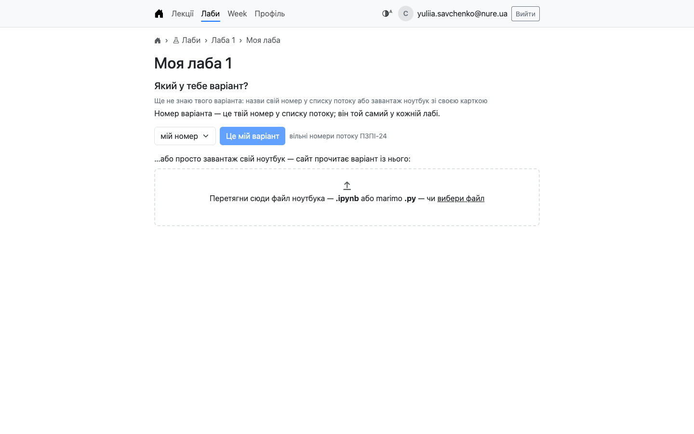
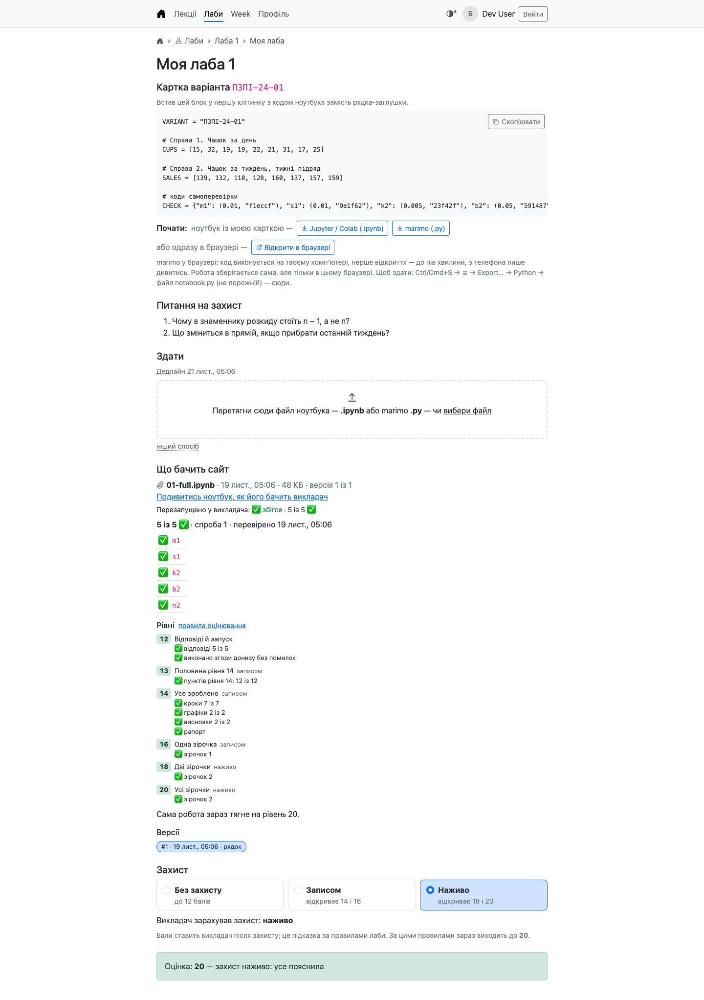
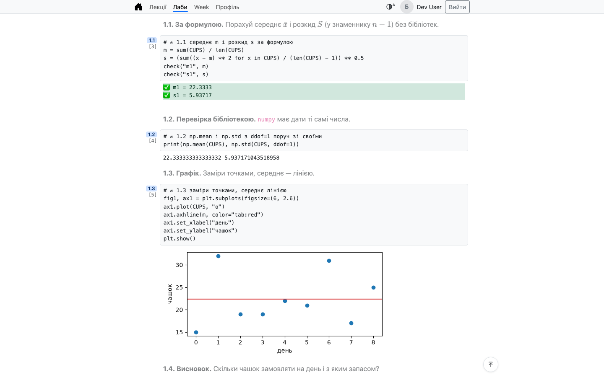
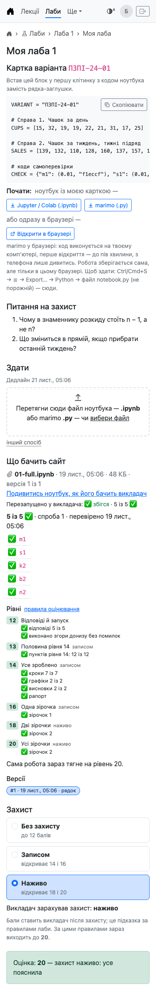
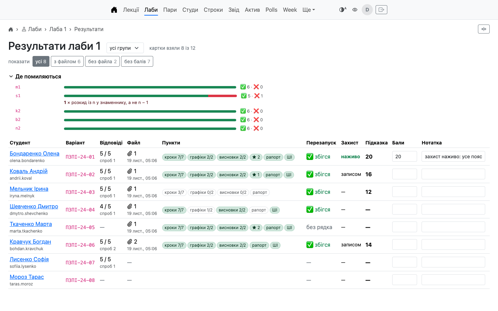
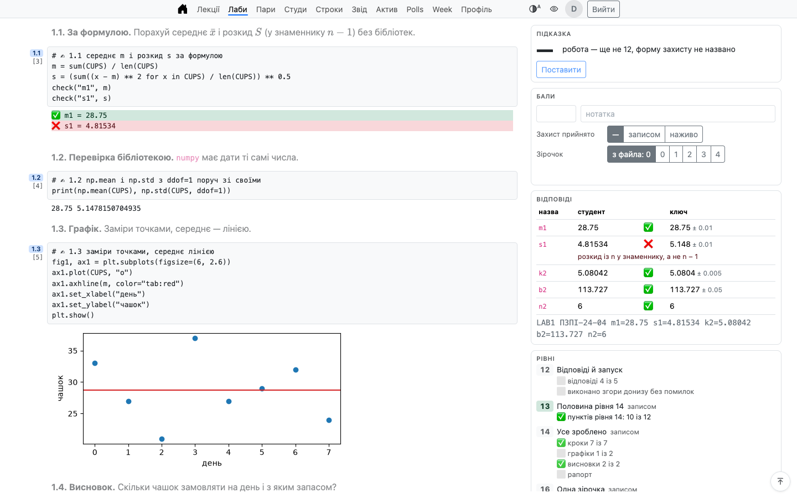
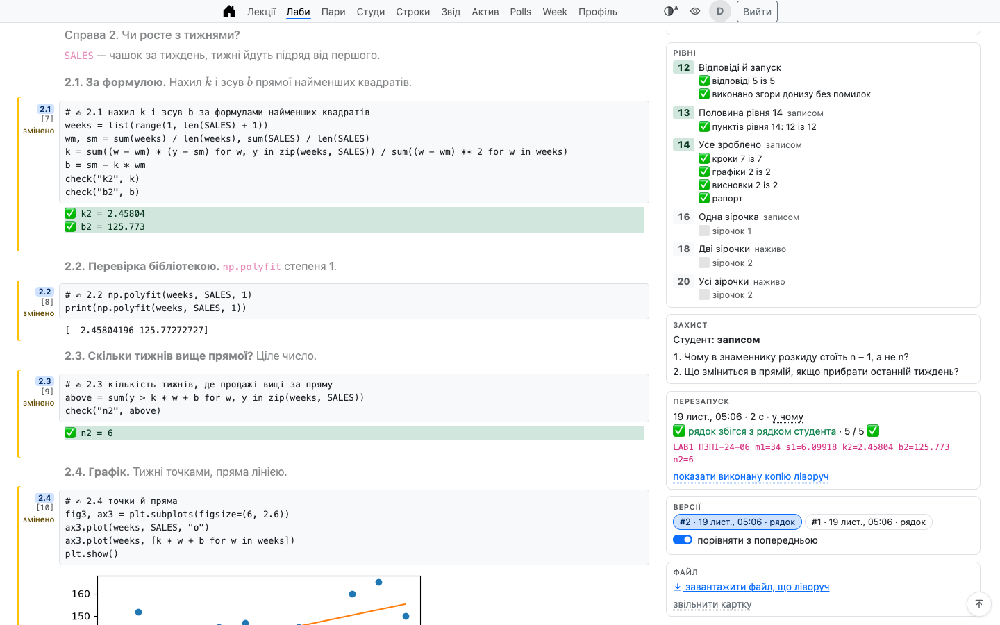
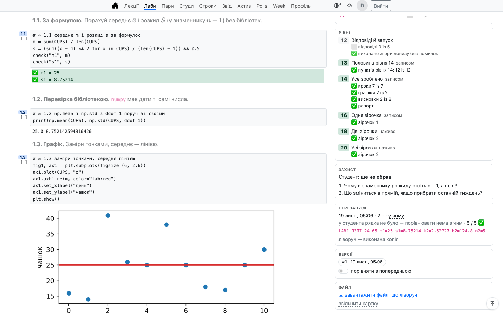
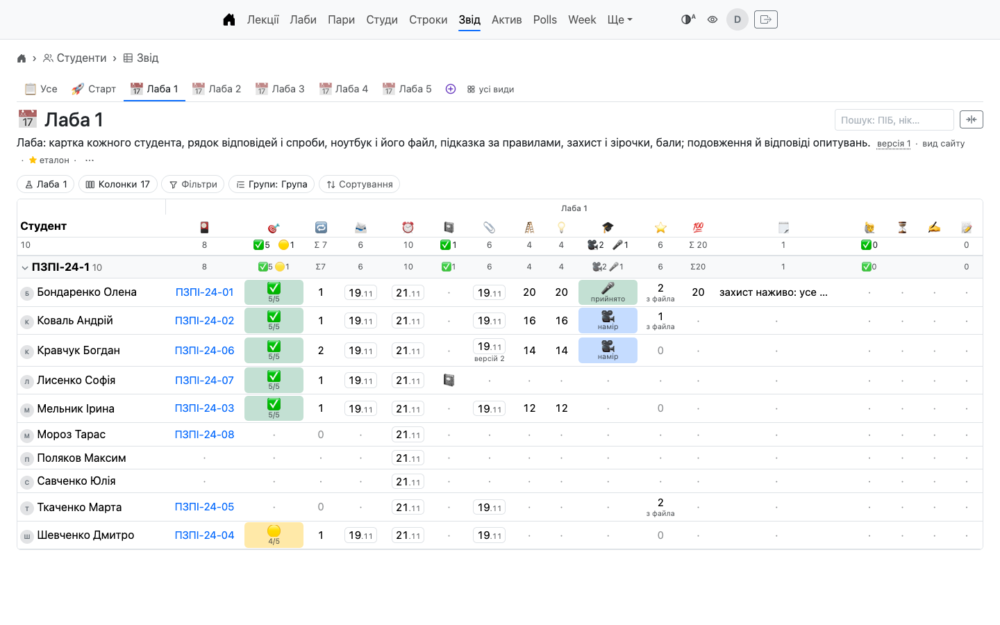

# T354 · Здача й перевірка лаб ods — звіт

`2026-11-19` · закомічено, без push · контракт — [plan.md](plan.md) · вибори — [T362](../T362-Q--ods-lab-handin-choices.md) · як організувати перевірку — [T356](../T356-C--ods-lab-check-org.md)

Сторінка-звіт зі схемами й знімками: [«Здача лаб ods #354 рев’ю»](https://claude.ai/artifact/QZAj5fss7Rd7uEJ8dFbFKP) — джерело [review.src.html](review.src.html), збірка `python3 build_review.py` → `review.html` (картинки всередині).

## Коротко

- Студент здає лабу **файлом ноутбука** на «Моїй лабі»: називає номер свого варіанта (або сайт читає його з файла), перетягує `.ipynb` чи marimo `.py` і одразу бачить, що бачить сайт: ✅ / ❌, пункти рівнів, «сама робота тягне на рівень N».
- Кожне завантаження — **версія байт у байт** з часом сервера; сервер **коду студентів не виконує**: розбирає файл як текст.
- Викладач має **таблицю потоку** з «де помиляються» і **стіл перевірки**: ноутбук, як запущений, поруч ключ, рівні, питання на захист, перезапуск, версії, бали; ← → між студентами.
- **Перезапуск** — на твоєму ноутбуці: `bin/nbrun` виконує кожну роботу в Docker без мережі й без дисків і кладе результат на сайт.
- **marimo в браузері** — третій спосіб поруч із Colab і marimo локально; **`check()` → сайт** у лабі 3 уже є.
- Студенти поки нічого з цього не бачать: ods не на сервері.

## Що зроблено

| № | Що | Як є тепер | Де |
|:-:|:--|:--|:--|
| 1 | Свій варіант | студент вибирає номер серед вільних номерів потоку або кидає файл — сайт бере варіант із картки у файлі; у наступних лабах той самий номер береться мовчки; викладач звільняє чи передає картку | `/labs/N/my` |
| 2 | Файл ноутбука | кожне завантаження — версія: оригінал байт у байт (zlib), sha256, час сервера, до 12 МБ; розбір без виконання (`.ipynb` — JSON, marimo `.py` — `ast`) | `/labs/N/my` · колекція `lab_files` |
| 3 | Показ ноутбука | як запущений: текст із формулами, код, виводи, графіки, помилки; режими «усе · лише своє · висновки»; HTML студента не проходить | `/labs/N/my/nb/<id>`, ліва частина столу перевірки |
| 4 | Що видно з файла | зроблені кроки, графіки, висновки, рапорт, зірочки, «виконано згори донизу», рядок відповідей; сповіщення бота «📎 ноутбук…» | «Що бачить сайт» на `/labs/N/my`, колонка «Пункти» |
| 5 | Підказка оцінки | драбина T228: 12 · 13 · 14 · 16 · 18 · 19 · 20 × форма захисту; «сама робота тягне на рівень N»; бали ставиш ти | «Рівні» на `/labs/N/my`, «Підказка» в таблиці |
| 6 | Стіл перевірки | ноутбук ліворуч; праворуч відповіді з ключем і назвою помилки, рівні, «Поставити N», захист і зірочки, питання на захист, перезапуск, версії з порівнянням; `[` `]` — сусідні студенти | `/labs/N/results/<варіант>` |
| 7 | Картина потоку | «Де помиляються» по кожній відповіді, хто — під мишкою; таблиця з файлом, пунктами, перезапуском, захистом, підказкою, балами; у «Зводі» — колонки файла, рівня роботи, підказки, захисту, зірочок | `/labs/N/results`, `/table` |
| 8 | Ноутбук зі своєю карткою, marimo в браузері | дві кнопки «Jupyter / Colab» і «marimo»; «Відкрити в браузері» — `marimo.app` з карткою і короткою інструкцією, як зберегти файл | `/labs/N/my` |
| 9 | Локальний перезапуск | `bin/nbrun build` один раз, далі `bin/nbrun <лаба> -t ods`; Docker без мережі й дисків; результат і виконана копія — на сайт | `bin/nbrun`, `bin/nbrun.d/` |
| 10 | `check()` → сайт | токен у картці від сайту; студент бачить «ноутбук на звʼязку: n із N ✅»; лаба 3 вже шле (T355), лаби 4–5 — ще ні | [live-snippet.md](live-snippet.md), `POST /api/variants/{lab}/live` |
| 11 | Контент у базі | дев-база `ods`: 314 карток (61 `ПЗПІ-24` + демо на кожну з пʼяти лаб, плюс 4 тестові лаби 1) і будова пʼяти лаб; картки ще ніхто не взяв; тексти сторінок лаб імпортує сесія T357; біля «Рівнів» — посилання «правила оцінювання» | `lab_io.py`, `/labs/about/grading` |

## Як це виглядає

Знімки зі стенда: лаба, студенти й числа вигадані.

-  «Моя лаба» без картки: вибрати номер або кинути файл.
-  «Моя лаба» цілком: картка, «Почати», «Здати», «Що бачить сайт», рівні, захист, оцінка.
-  «Мій ноутбук» — файл студента, як його бачить викладач.
-  Та сама «Моя лаба» на телефоні 390 px.
-  «Результати лаби 1»: «Де помиляються» й таблиця потоку.
-  Стіл перевірки: ноутбук ліворуч, ключ і рівні праворуч.
-  «Порівняти з попередньою»: змінені клітинки другої версії позначено жовтим.
-  Перезапуск: виконана копія ліворуч; у студента рядка не було — сайт так і каже.
-  «Звід», вид «Лаба 1»: нові колонки файла, рівня роботи, підказки, захисту, зірочок.

## Перевірено

| Що | Результат |
|:--|:--|
| Смоуки сайту ods: labs · table · ods · nb · files | 46 · 17 · 10 · 39 · 49 — усі ✅ |
| Смоуки платформи з теки ods, 24 файли | усі ✅ |
| `vite build` сайту ods | збирається |
| Стенд у headless Chrome: 26 сценаріїв студентом і викладачем | ≈ 16 пройшли одразу, решту виправлено й пройдено вдруге (21 правка, список — `.dev/.drafts/T354/qa.md`) |
| Розбір на справжніх розвʼязаних ноутбуках пʼяти лаб (поза git, лише числа) | кроки 16/16, 18/18, 18/18, 17/17, 20/20; усі відповіді ✅ (13, 14, 14, 13, 14); рівень роботи — 20 у лабах 1, 3, 4, 5 і 13 у лабі 2 (її розвʼязок на диску виконано без картинок — перезапустити `lab2/tools/run.py`); порожні шаблони — «нічого не зроблено» |
| `bin/nbrun` на 20 розвʼязаних ноутбуках пʼяти лаб (Jupyter і marimo) | усі чисті, 4–10 с кожен, рядок відповідей той самий, що збережений |
| `bin/nbrun` проти стенда | «збігся», «не збігся» (рядок, підправлений руками) і «рядка не було» показуються правильно; marimo-робота отримує графіки з виконаної копії |
| Девʼять ворожих ноутбуків у пісочниці | усі стримано — див. нижче |
| Markdown студента | HTML, посилання `javascript:` і `\href` у формулі виходять текстом |
| marimo в браузері | шаблон і розвʼязки лаб 1 і 5 виконуються самі, рядок відповідей збігся з локальним до символа |

## Не перевірено

- Сам Colab: відкриття шаблону, «ноутбук зі своєю карткою», `check()` → сайт із Colab.
- Firefox і Safari — лише headless Chrome; телефон — лише один знімок 390 px.
- Справжні сповіщення Telegram — тексти перевіряє смоук.
- Справжній `https://ods.labs.in.ua`: сайт не на сервері.
- «Взяти файл за посиланням» Colab / Drive на справжньому посиланні.

## Шорсткості

1. **Маршрути `/labs/N/my` і `/labs/N/results`** у коміті `31ca915` відкривали чужу сторінку. Полагоджено в HEAD комітом `27fb533` (сесія T357) — нічого не треба.
2. **«Графіки n із N»** рахує клітинки з графіком у розвʼязаному ноутбуці (2 · 2 · 5 · 2 · 8 для лаб 1–5), а тексти лаб називають 3 · 2 · 4 · 2 (+1 із шаблону) · 6: підказка буває суворішою чи мʼякшою за текст. → [T362](../T362-Q--ods-lab-handin-choices.md) Q3.
3. **Перша зірочка лаби 5** читає картинки з теки: marimo в браузері їх не має (клітинка падає), локальний перезапуск теку дає. → T362 Q5.
4. **marimo-шаблон лаби 1** у першій клітинці досі пише про меню Colab. Це текст лаби — для T357 / T355.
5. **Файл за посиланням Colab / Drive** написано й перевірено із заглушкою, на справжньому посиланні — ні. → спробувати після деплою на одному своєму посиланні.
6. **ods не на сервері**: студенти нічого з цього не бачать. → деплой.
7. **`BODY_MAX` = 1100 КБ** у маніфесті `apps/ods-labs` (vps-infra). Ноутбук із графіками більший, а звіт перезапуску з виконаною копією — до ≈ 16 МБ. → підняти до ≈ 20 МБ.
8. **Не перевірено** Colab, Firefox / Safari, телефон, Telegram, справжній домен — список вище.

## Пісочниця: що вона тримає і чого ні

Один ноутбук — один контейнер Docker: без мережі, без жодної теки хоста, корінь лише для читання, 1 ГБ памʼяті, одне ядро, 256 процесів, 5 хвилин, не більше 60 МБ виводу; ноутбук заходить через stdin. Версії закріплено: Python 3.12, numpy 2.5, scipy 1.18, sympy 1.14, matplotlib 3.11, pandas 3.1, scikit-learn 1.9, marimo 0.25.2. Образ `ods-nbrun` — 928 МБ, збирається ≈ 47 с.

| Що пробував ноутбук | Що сталося |
|:--|:--|
| вийти в мережу | помилка всередині, назовні нічого |
| прочитати файли хоста | хоста в контейнері нема |
| записати на диск | корінь лише для читання, `/tmp` — до 512 МБ |
| fork-бомба | зупинено за 4–6 с |
| зайняти 4 ГБ памʼяті | ядро Jupyter убито, решта жива |
| нескінченний цикл | клітинка — 120 с, ноутбук — 270 с, далі `docker kill` |
| надрукувати 500 МБ | обрізано |
| підробити результат | перезапуск усе одно каже правду |
| `pip install`, `input()` | не зависає |

Чого коробка **не** тримає: діри в ядрі Linux чи в самому Docker. Контейнер ділить ядро з віртуальною машиною Docker Desktop, а в неї за замовчуванням спільна тека `/Users`. Тримай Docker Desktop оновленим; якщо жоден інший проєкт не монтує теки, прибери `/Users` у Settings → Resources → File sharing (T362 Q9).

Скрипти `bin/` хочуть Python ≥ 3.10, а системний `python3` macOS — 3.9: запускати `~/.venvs/python-labs/bin/python bin/nbrun …`.

## marimo в браузері

Вердикт досліду: **давати можна, з інструкцією**. Посилання з карткою відкривається на `marimo.app`, ноутбук виконується сам за 10–30 с, графіки малюються, рядок відповідей збігається з локальним до символа. Дві пастки: робота живе в одній комірці браузера (друге відкриття кнопки й перша правка стирають попередню), а експорт `.py` до першого збереження дає порожній файл. З телефона — лише подивитись. Подробиці — `.dev/.drafts/T354/marimo.md`.

Інструкція студентам (коротша — під кнопкою на «Моїй лабі»):

1. «Відкрити в браузері»: за 10–30 с ноутбук сам виконається, картка вже вставлена.
2. Працюй на компʼютері, в одному браузері: marimo зберігає роботу сам, але лише в цьому браузері, і копія одна.
3. Повертаєшся — відкривай просто **marimo.app**: там остання копія. Кнопка на сайті дає чистий шаблон, і перша правка в ньому зітре попередню роботу.
4. Наприкінці кожного сеансу: Ctrl / Cmd + S, потім ☰ → Export… → Python → Export notebook source; збережи `notebook.py`.
5. Перевір, що файл не порожній (≈ 20 КБ), і здай його на сайт.

## Чекає тебе

1. **Глянути стенд** (вигадані студенти й лаба): `http://127.0.0.1:5032/api/auth/dev-login?next=/labs/1/results`.
2. **Відповісти на [T362](../T362-Q--ods-lab-handin-choices.md)**; мовчання = «a».
3. **Деплой ods** (Google-ключі) з `BODY_MAX` ≈ 20 МБ у `apps/ods-labs` і `AGENT_TOKENS` у `shared/env` сайту.
4. **`ODS_URL` / `ODS_TOKEN`** у `.site/.env` — щоб `bin/nbrun -t ods` бачив сервер.
5. **`bin/nbrun build`** — один раз, ≈ 47 с.
6. **Одне оголошення студентам**: «зайди на сайт, назви номер свого варіанта, завантаж файл ноутбука».
7. **Дедлайн лаби 2 — 21 листопада, післязавтра.**

## Як підняти стенд

- Відкрити: `http://127.0.0.1:5032/api/auth/dev-login?next=/labs/1/results` (викладач); сценарії й кука студента — `.dev/.drafts/T354/qa.md`.
- З нуля: `cd .dev/.drafts/T354/stand && bash down.sh; bash seed.sh && bash up.sh`.
- Після перезавантаження Mac скретч-дані зникають — спершу `source env.sh && uv run fake.py "$SP/data"`.
- Порти 8032 / 5032 / 9334, база `ods_t354_stand`.

## Коміти

- `5ebf8cc` docs(ods): task stub — lab hand-in and review on the site
- `7553d45` docs(ods): contract for lab hand-in and review — data, parsing, grade hint, api
- `646ea9e` docs(ods): live report of the lab hand-in work — state and how to resume
- `8105534` feat(ods): notebook files of a lab — versions, parsing without running, grade hint
- `31ca915` feat(ods): pages of lab hand-in and review; pages of a lab beyond its task
- `85883c6` feat(ods): bin/nbrun — re-run students' notebooks in a locked Docker box
- `76c9aa5` docs(ods): the check() → site snippet for the service cell of labs 3–5
- `ba7b967` fix(ods): lab hand-in after a walk on the stand — ladder, card token, re-run, table
- поруч: `fc87cb2` — T356 (перевірка без GitHub); `c01c79c` — фрагмент `check()` у лабі 3 (T355); `27fb533` — маршрути (T357)

## Що далі

Перші три ідеї з [T356](../T356-C--ods-lab-check-org.md):

- **«Строки» ods із файла** — вчасно = файл чи рядок з усіма ✅ до дедлайну (S) · T362 Q8.
- **Зауваження до клітинки** — клацнув клітинку, написав; студент бачить у своєму ноутбуці, нова версія показує, що виправлено (M).
- **Бот студентові** — «поставлено бали», «є зауваження» (XS–S).
