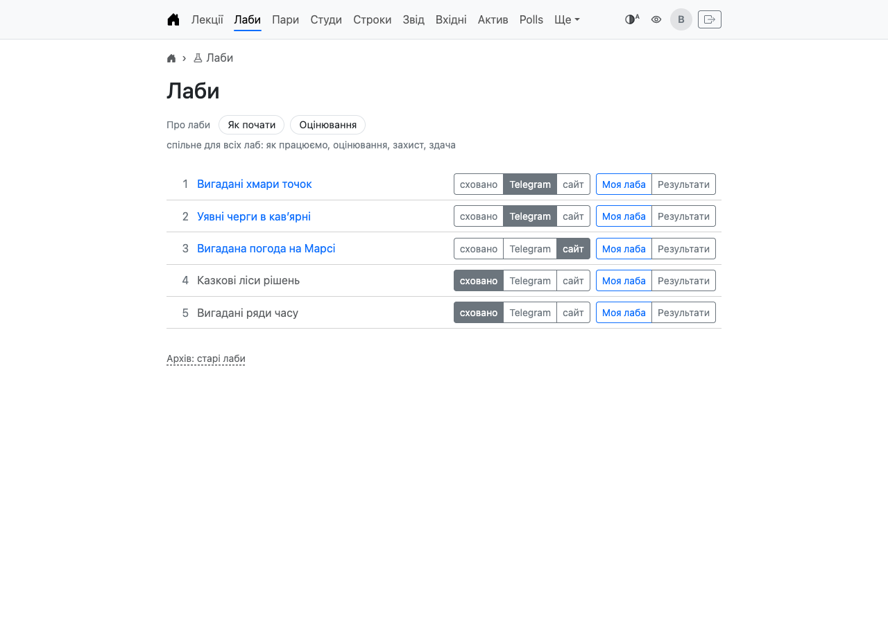
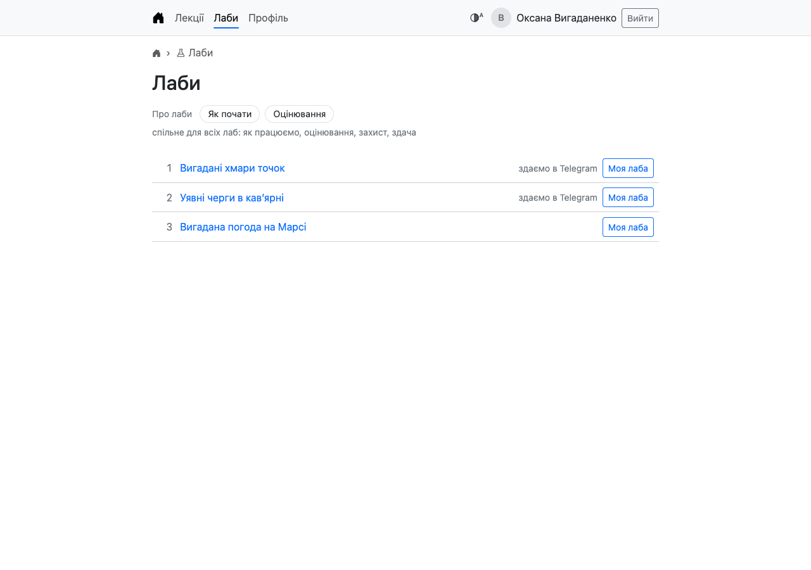
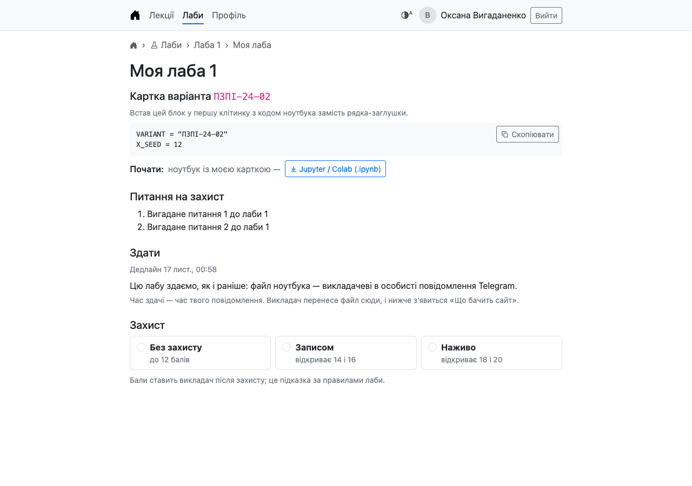
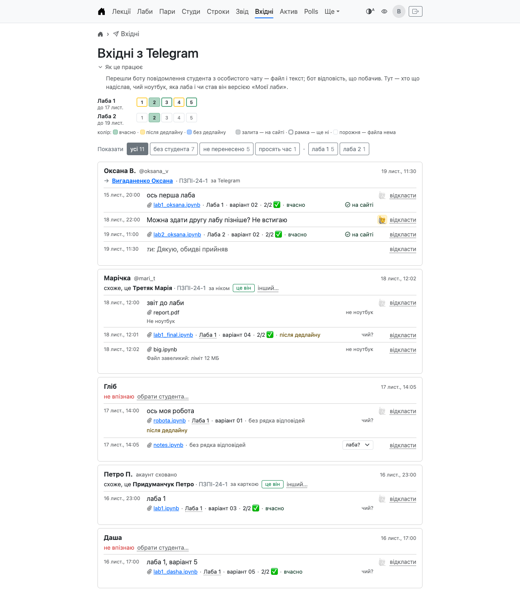
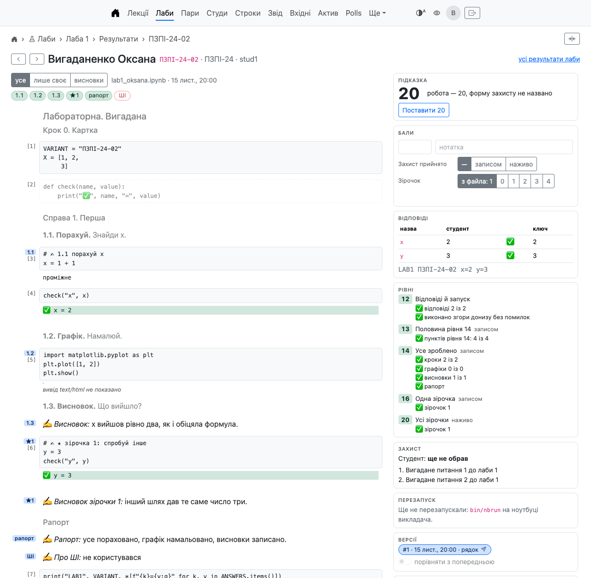
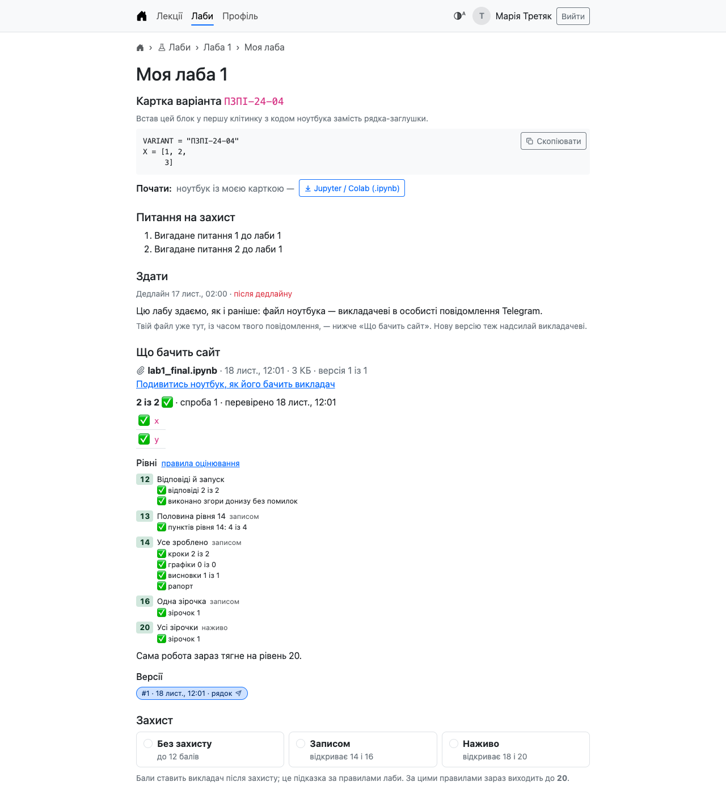
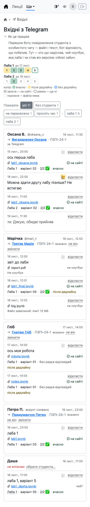

# T368 · Звіти лаб ods: гейти лаб і перенос із Telegram — звіт

`2026-11-20` · закомічено, без push · контракт — [plan.md](plan.md) · рішення й порядок дій — [T370](../T370-P--lab-reports-flow.md) · вибори — [T371](../T371-Q--lab-reports-choices.md)

Сторінка-звіт зі схемами й знімками: [«Звіти лаб #368 рев’ю»](https://claude.ai/artifact/Ki55TbKFpFPcvxFBxVoZrJ) — джерело [review.src.html](review.src.html), збірка `python3 build_review.py` → `review.html` (картинки всередині).

## Коротко

- **Гейти лаб:** кожна лаба має стан для студентів — сховано · Telegram · сайт. Зараз: лаби 1–2 — «здаємо в Telegram», лаба 3 — на сайті, лаби 4–5 сховано. Перемикач — у викладача на `/labs`. Їде першим деплоєм.
- **Перенос із Telegram:** викладач пересилає боту повідомлення студентів; сайт читає ноутбуки без виконання, впізнає автора й робить із файла версію «Моєї лаби» з часом повідомлення. Сторінка «Вхідні» показує, хто що надіслав. Їде другим деплоєм.
- **Версії** були ще з T354; перенесена з Telegram стає в їх ряд за часом повідомлення, з позначкою.
- Справжнього Telegram ще не було: бот ods не запущено.

## Що зроблено

| № | Що | Як є тепер | Де |
|:-:|:--|:--|:--|
| 1 | Стан лаби | `hidden` · `telegram` · `site`; старт — `LAB_GATES` у `site.env`, клік викладача перекриває (історія змін) | `lab_gates.py`, `/api/labgates`, `/labs` |
| 2 | Схована лаба | студентові 404 на текст, частини, картинки, файли, «Мою лабу», картки; нема в переліку, у пігулках лекцій, у лічильнику домашньої | `core/routes/guide.py` (гачок `STAFF`), `routes/media.py`, `routes/lab_pages.py` |
| 3 | Лаба «Telegram» | текст і картка є, номер назвати можна; файл, посилання й рядок відповідей — 409 зі словами; на «Моїй лабі» замість здачі — куди надсилати | `routes/labs.py`, `routes/lab_files.py`, `LabByTelegram.vue` |
| 4 | Бот бере переслане | приватний чат, адмін, переслане від людини: автор, час оригіналу, слова, файл; ✍ на кожне, одне зведення на пачку | `bot/intake.py`, `bot/intake_take.py`, `bot/intake_say.py` |
| 5 | Читання файла | ноутбук чи ні; лаба — з рядка відповідей, шаблону або назви; картка; рядок проти ключа | `intake_read.py` |
| 6 | Чий | напевно — привʼязаний Telegram; здогад — картка, нік, імʼя; слово викладача | `intake_match.py` |
| 7 | Версія на сайті | `store(…, at, via="telegram")`: час повідомлення; той самий файл удруге — та сама версія; раніший за останній не міняє «останній» | `lab_store.py`, `intake_apply.py` |
| 8 | «Вхідні» | смужки номерів по лабах, фільтри, люди картками, стан кожного файла, 🙋, «відкласти» | `/intake`, `/api/intake` |
| 9 | «Моя лаба» | студент привʼязав бота й відкрив сторінку — картка й файл із Telegram зʼявились самі | `routes/labs.py` → `settle(user)` |
| 10 | Відповідь на переслане | `/due`, `/note` відповіддю на переслане повідомлення стосуються автора оригіналу | `core/bot/notes.py` |
| 11 | Домашня | під «Першими кроками» — рядок «Далі — Лаби → Лаба 3 → „Моя лаба“» | `vue/src/site.js` |

## Як це виглядає

Знімки зі стенда: люди, лаби й числа вигадані.

-  «Лаби» у викладача: перемикач у кожному рядку.
-  «Лаби» у студента: лише відкриті.
-  «Моя лаба» лаби, яку здають у Telegram.
-  «Вхідні»: смужки, фільтри, люди, файли.
-  Версія з Telegram у ряду версій на столі перевірки.
-  «Моя лаба» студента: файл із Telegram, надісланий після дедлайну.
-  «Вхідні» на телефоні 390 px.

## Перевірено

| Що | Результат |
|:--|:--|
| Смоуки ods: gates · labs · files · table · content · ods · nb · intake | 25 · 49 · 49 · 17 · 31 · 10 · 39 · 53 — усі ✅ |
| 24 платформні смоуки з теки ods | 711 перевірок ✅ |
| python-сайт: guide · agent · view_as · notes · due · bot | усі ✅ |
| `vite build` сайту ods | збирається |
| Розпізнавання лаби на справжніх шаблонах і розвʼязках пʼяти лаб, Jupyter і marimo, і на «жодного разу не запущених» | 25 з 25; рядок відповідей звірено з ключем |
| Стенд у headless Chrome: гейти — два кола, «Вхідні» зі справжнім API — два кола; 22 сценарії | знахідки виправлено, список нижче; останнє коло — 7 із 7 |

## Не перевірено

- Справжній Telegram: пересилання, приховані акаунти, скачування файла ботом — бот ods ще не запущено.
- Справжні ноутбуки студентів — лише наші шаблони й розвʼязки.
- Firefox, Safari, справжній телефон — лише headless Chrome.
- Справжній `https://ods.labs.in.ua`.

## Що знайшла перевірка й що з цим зроблено

- Телефон: рядок `/labs` у викладача вилазив за край → дії лягають під назву.
- Текст схованої лаби запитувався й давав 404 у консолі → сторінка спершу дивиться на гейти.
- «Потрібна для» на лекції зсувала текст → список методички приходить разом із текстом.
- Викладач на «Моїй лабі» бачив зону файла лише після картки → бачить завжди.
- Лабу сховали, поки вкладка відкрита → «такої сторінки нема», а не блок вибору номера.
- «На сайті» для ноутбука без картки вело на таблицю → рядок запамʼятовує картку, на яку лягла версія.
- Студент не бачив «після дедлайну» для перенесеного пізнього файла → бачить, щойно файл на сайті.
- Рядок файла на «Вхідних» розпадався на довгих номерах карток → короткий номер, назва не стискається першою.
- Зведення бота: «без рядка» для ноутбука без рядка відповідей, «Лаба ?» з великої.

## Шорсткості

1. **Справжнього Telegram не було.** Перше пересилання — одна розмова, глянути зведення.
2. **Ноутбук без картки й без рядка**, якому викладач сам назвав лабу, стає версією студента, якщо той уже тримає картку, — навіть якщо це просто нотатки. Попередження нема.
3. **Інший студент після переносу:** версія лишається за першим; файл переходить лише передачею картки на «Результатах».
4. **«Не він» для розмови, привʼязаної за Telegram, не тримається:** наступний перегляд знову привʼяже. Кнопки для цього випадку на сторінці нема.
5. **🙋 за словами в тексті** дає хибні збіги («перенесли пару»); перемикається кліком.
6. **Зведення бота не каже «після дедлайну»** — це видно на «Вхідних».
7. **Смужка — одна на лабу:** кілька потоків з однаковими номерами злиплися б. Зараз потік один.
8. **«Строки» ods ще не рахують «вчасно» з файла** — [T362](../T362-Q--ods-lab-handin-choices.md) Q8.

## Чекає тебе

1. Перший деплой — за чеклістом [T367](../T367--ods-state/report.md); у гілці має бути `9c0a119`.
2. `/students` → імпорт списку потоку з поштами — до оголошення.
3. «Строки» → дедлайни лаб 1, 2, 3.
4. Оголошення студентам — текст у [T370](../T370-P--lab-reports-flow.md).
5. [T371](../T371-Q--lab-reports-choices.md): Q1–Q2 (бонус) і Q7 (дедлайни) — до оголошення; мовчання = «a».
6. Другий деплой — перенос (`7cea16c`), з перезапуском API й бота ods; далі пересилання боту.

## Як підняти стенд

- Відкрити: `http://127.0.0.1:5034/api/auth/dev-login?next=/intake` (викладач).
- З нуля: `cd .dev/.drafts/T368/stand && bash tree.sh && bash seed.sh && bash up.sh && bash seed_intake.sh`.
- Порти 8034 / 5034 / 9344, база `ods_t368_stand`; сценарії — `bash run.sh s1 | s2 | s7 | s9 | r2 | i1 | i9 | i10`.

## Коміти

- `cf38ad0` feat(ods): lab gates — hidden, handed in by Telegram or on the site
- `040b049` feat(ods): seams of the Telegram intake — plan
- `e07147f` feat(ods): home note points to the lab card; lab reports flow
- `9c0a119` fix(ods): lab gates after a walk on the stand
- `4d686a1` feat(ods): Telegram intake — forwards read, matched, made versions
- `fd6775e` feat(ods): «Вхідні» — strips of numbers, people, files
- `8d02260` fix(ods): the Telegram intake after a walk on the stand
- `7cea16c` fix(ods): the strips' legend names both of its rows

## Що далі

- Бот студентові: «файл лаби N перенесено на сайт» (XS–S) — T371 Q6.
- «Строки» ods з файла (S) — T362 Q8.
- Показ ноутбука на «Вхідних» до переносу (S); подовження кнопкою біля 🙋 (S).
- Третій «перший крок» на домашній із галочкою (XS).
