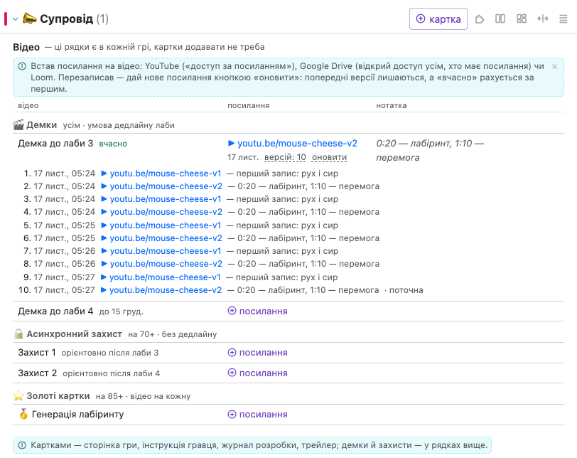
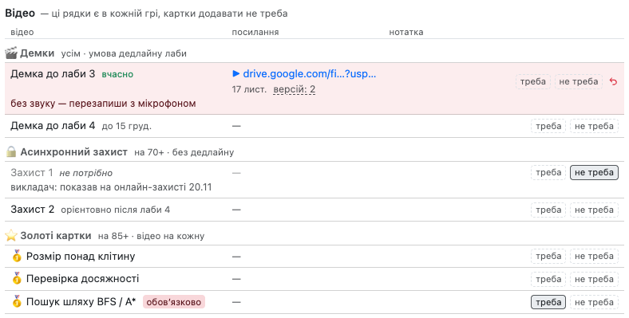
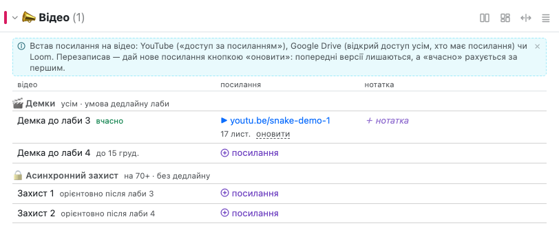
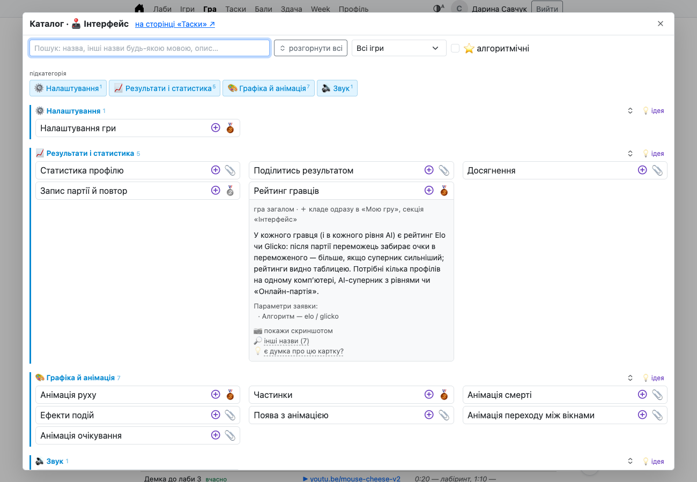
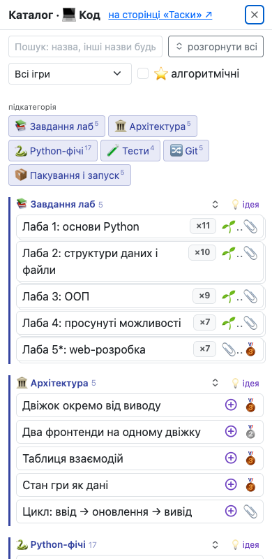
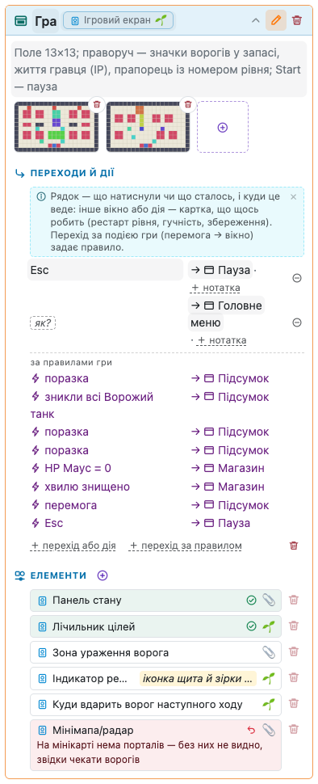

# T318 · Опис гри v12 — відео в «Супроводі», простора панель каталогу, шлях до «Тасків», переходи без назви — план і звіт

`2026-11-16` · ⚙️ задача · рішення — [T323](../../../games/.t/T323-P--game-desc-v12-design.md) · вибори — [T324](../../../games/.t/T324-Q--game-desc-v12-choices.md) · збереження відео — [T325](../../../reports/.t/T325-C--video-archive.md) · поруч — [T316](../T316--table-v2/plan.md) («Звід», інша сесія)

Запит Vitalik 2026-11-17, чат — дослівні уривки в [T323](../../../games/.t/T323-P--game-desc-v12-design.md).

## Запит по пунктах

✅ зроблено · ❓ вибір у T324 (мовчання = «a») · ⏸ не зроблено, причина поруч

1. ✅ «Супровід»: відео зафіксовані рядками, картки додавати не треба. ❓ Q1
   - демка до лаби 3 і до лаби 4, асинхронний захист 1 і 2, по рядку на кожну заявлену золоту картку;
   - групи за шкалою: демки — усім, захист — на 70+, золото — на 85+.
2. ✅ Демку можна оновлювати, версії зберігаються; «вчасно» рахується за першим посиланням. ❓ Q6, Q7
3. ✅ Демка — умова дедлайну: рядок показує дедлайн лаби цього студента, «вчасно» / «після дедлайну» / «дедлайн минув»; підказка у «чого бракує» за два тижні.
4. ✅ Асинхронні захисти без дедлайну, названі «Захист 1» і «Захист 2», з орієнтиром «після лаби 3 / 4».
5. ✅ Після онлайн-захисту ти знімаєш рядок: «не треба» одним кліком, рядок чому — в панелі. ❓ Q5
6. ✅ Золоті картки: рядок на кожну; «треба» — один клік, рядок стає червоним. ❓ Q4
7. ✅ Студенти можуть здавати відео вже зараз: у простому режимі секція «Відео». ❓ Q2
8. ✅ Збереження самих відео — подумав: [T325](../../../reports/.t/T325-C--video-archive.md); нагадування — у «Наступному кроці» вузла reports. ❓ Q13
9. ✅ З секції гри до «Тасків»: значок на заголовку секції, посилання у вікні каталогу, «Переглянути всі просторо» під списком «＋». ❓ Q8
10. ✅ Перехід без назви зберігається; «як?» пунктиром; ланцюжок «клац-клац-клац». ❓ Q10, Q11
11. ✅ Переходи за правилами — окремо, під підписом «за правилами гри»; «＋ перехід за правилом» на ігровому екрані.
12. ✅ Простора панель: вікно каталогу над сторінкою гри, ті самі картки, що на «Тасках». ❓ Q9
13. ✅ «Що ще можна зробити» — вісім пунктів з розмірами: [T323](../../../games/.t/T323-P--game-desc-v12-design.md) §5.
14. ⏸ Картка каталогу «Відео-демка гри» дублює рядок — каталог правиться на сервері, чекає слова. ❓ Q3
15. ⏸ Текст «Здачі» в методичці про те, де здавати відео, — після деплою, на слово. ❓ Q12

## Як це виглядає

### «Супровід» → «Відео»

- Рядки стоять від створення гри. Посилання вставляється в рядок; поруч нотатка.
- «оновити» — нова версія; «версій: N» розгортає всі з датами.
- Не посилання — поле лишається відкритим зі словами сервера.

- На паспорті студента: «треба» / «не треба» в останньому стовпці; клік по рядку — панель із «чому», «зараховано / повернуто» і словом студентові.

- Звичайний студент у простому режимі: третя секція «Відео».

### Вікно каталогу

- Значок пазла на заголовку секції. «＋» додає, вікно лишається; галочка веде до місця в грі.
- На телефоні — на весь екран: 

### Переходи

- «як?» замість назви; «за правилами гри» — окремо; унизу «＋ перехід або дія» і «＋ перехід за правилом».

## Що де в коді

Бекенд:

- `app/api/models/video.py` — `Video`: гра, рядок, версії, слово викладача.
- `app/api/videos.py` — склад рядків (`DEMO_LABS`, `DEFENSES`, `GOLD`), дедлайн студента, рядки для сторінки, зведення для списків.
- `app/api/routes/my_videos.py` — `PUT /api/my/game/videos/{slot}` (студент; під `X-Game-Of` — викладач за студента), `PUT /api/students/{nick}/videos/{slot}` (слово викладача).
- `routes/student_games.py` — паспорт несе `videos`, рядок списку студентів — `game.videos` і відео в `waiting`.
- `game_log*.py` — відео в історії гри; `bot/game_alerts.py` — алерти `video`, `video_word`.
- `routes/my_parts.py` — пункт меню лишається, якщо має назву, вікно або картку.
- `tests/smoke_videos.py` — 30 перевірок; `smoke_games.py` — плюс одна.

Фронт:

- `videos.js`, `components/VideoSlots.vue`, `VideoRow.vue`, `VideoWord.vue` — блок, рядок, панель викладача.
- `shortLink.js` — «посилання, як його читають», спільне з таблицею заявок.
- `core/ui/components/Sheet.vue` — просторе вікно над сторінкою (ядро: годиться будь-якому сайту).
- `components/CatalogWindow.vue` — каталог у цьому вікні.
- `gameCtx.js` — у яку гру пише «＋» каталогу: «моя» на «Тасках», редагована — у вікні.
- `taskFilter.js` — стан фільтра з адреси або з наданого обʼєкта.
- `sections.js` — `catalogOf(id)`: які картки стосуються секції; `SIMPLE` з «Відео».
- `components/MenuItems.vue`, `MenuTarget.vue` — рядок переходу без назви, ланцюжок, переходи за правилами.

Коміти (2026-11-17, без push):

1. `feat: keep a window transition that has no name yet`
2. `feat(api): videos a game is asked for, with versions and a word`
3. `feat(vue): «Супровід» opens with the videos every game is asked for`
4. `refactor(vue): catalog cards take the game and the filter from context`
5. `feat(vue): the catalog in a window over the game's page`
6. `feat(vue): add transitions window after window`
7. `feat(api): a video with a link waits for the teacher's word`
8. `docs(vue): the editor's context names its videos and catalog window`
9. доки — цей тікет, T323–T325, README вузлів

## Перевірено

Стенд: API 8033, Vite 5033, headless Chrome 9335, база `python_labs_stand3` з демо-студентами; дев-базу й дев-сервер не чіпав.

- Відео, власник: посилання → «вчасно», нотатка, друга версія, список версій, погане посилання, підказка про дедлайн.
- Відео, викладач: «треба», «не треба» з рядком чому, «повернуто» зі словом, історія гри.
- Простий режим: окремий запуск API з `GAME_DEPTH=simple` і звичайним (не тестовим) студентом — секція «Відео» є, посилання зберігається.
- Вікно каталогу: з заголовка секції, дві картки поспіль, пошук, галочка → місце в грі, Esc; з «＋ елемент» — картка сіла на вікно; секція з кількома категоріями; читач — галочки без «＋»; пісочниця зразка — пише в копію, «Моя гра» не змінилась; телефон 390 px; темна тема.
- «Таски»: «＋» і галочка-посилання працюють, як раніше.
- Переходи: ціль першою, «як?» у спокої й у читача, три переходи ланцюжком, Esc, «＋ перехід за правилом» відкриває правило з ефектом «відкрити вікно».
- Смоуки: повний прогін — підсумок у розділі нижче.
- Збірка `vite build` проходить (сторінку «Зводу» сусідньої сесії на час перевірки підмінено заглушкою лише в конфігу стенда).

Не перевірено:

- Safari, Firefox, Windows, справжній телефон.
- Справжній Telegram: алерти відео йшли в порожній токен стенда.
- Дедлайни груп: на стенді дедлайн один для всіх; перенесений дедлайн студента перевіряє смоук.

## Смоуки

Повний прогін 2026-11-17, кожен файл на власній скретч-базі: **1226 з 1227** у 34 файлах.

- `activity` 35/35 · `agent` 33/33 · `ai` 54/54 · `attendance` 25/25 · `auth` 23/23 · `bot` 19/19 · `card_history` 19/19 · `due` 29/30 · `errors` 21/21 · `events` 21/21 · `game_history` 38/38 · `games` 250/250 · `guide` 26/26 · `import` 14/14 · `labs` 48/48 · `lessons` 32/32 · `log` 16/16 · `ludopedia` 11/11 · `moments` 21/21 · `notes` 20/20 · `notify` 27/27 · `polls` 21/21 · `polls_api` 42/42 · `proof` 31/31 · `refs` 25/25 · `sandbox` 32/32 · `table` 44/44 · `teacher_edit` 23/23 · `tg_paste` 29/29 · `tiers` 45/45 · `videos` 30/30 · `view_as` 32/32 · `views` 53/53 · `week` 37/37
- Не пройшло: `smoke_due` — одна перевірка («/due 1 → the line carries 🙋 and 💬»); файл і код під ним цією задачею не змінювались.
- Нові: `smoke_videos` (30), одна перевірка в `smoke_games` (пункт меню без назви).

## Співпраця з іншими сесіями

- «Звід» (T315–T317): домовились про файли на старті; `game.videos` у рядку списку студентів — її джерело для колонки «демо»; форму поля надіслав окремою запискою.
- «Спрощений режим сторінки гри»: писатиме реєстр можливостей замість `ed.simple`; мої правки в `sections.js`, `GameEditor.vue`, `TaskCard.vue`, `TaskAdd.vue` закомічені до її першої правки; прохання — лишити «Відео» в основі без перемикача.
- Спільне дерево на час роботи було зламане чужою незавершеною сторінкою «Зводу» — у своєму стенді підмінив її заглушкою в конфігу Vite (скретчпад), репозиторій не чіпав.
- Сценарії стенда й скрипти — `.dev/.drafts/T318/scripts/` (поза git).

## Деплой

- **З перезапуском API**: нова колекція `videos`, нові маршрути. Бот — без змін у коді бота, але алерти шле API.
- Імпорт каталогу не потрібен.
- Після деплою: дедлайни лаб 3 і 4 мають стояти на «Строках» — від них рядки демок беруть дату.

## Що помітив

1. `smoke_due` падає на одній перевірці («/due 1 → the line carries 🙋 and 💬»). Код під ним (бот ядра, `/due`) я не чіпав; у «Наступному кроці» кореня `smoke_due` уже стоїть як XS після v8. Чи падав він до цієї задачі — не перевіряв.
2. Заголовок секції «Відео» в простому режимі має перемикачі стовпців, яким там нема чого перемикати. Не чіпав: сесія «Спрощений режим» переписує цю частину.

## Твої думки та питання

> 
