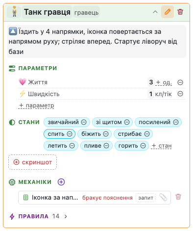
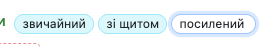
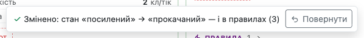
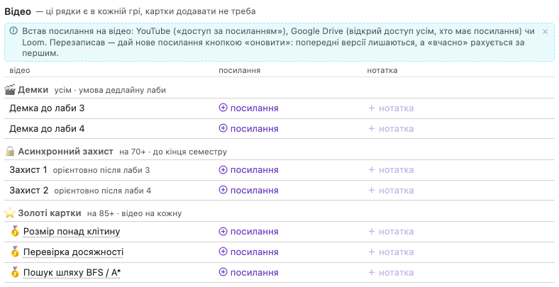
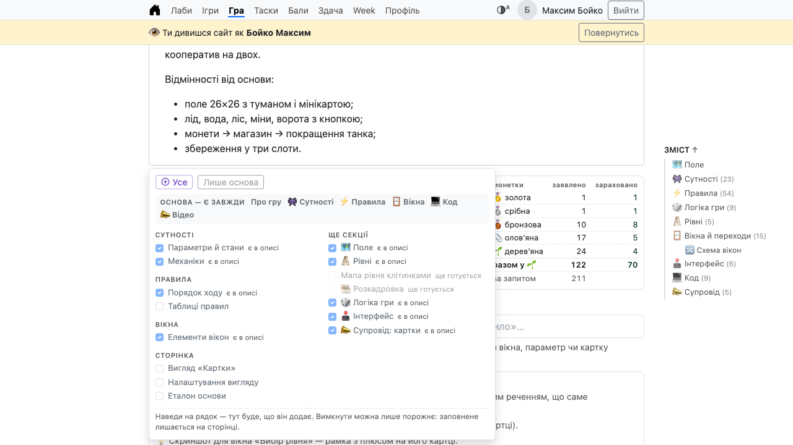
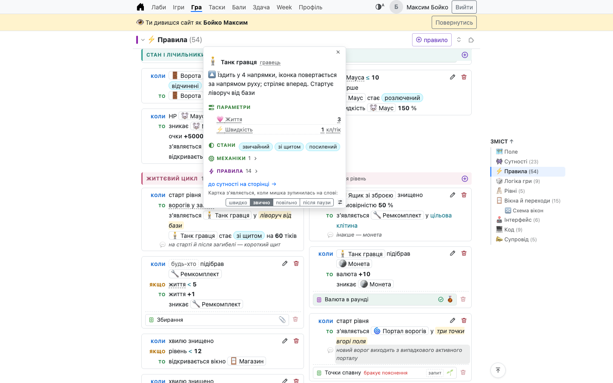
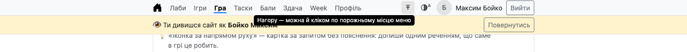
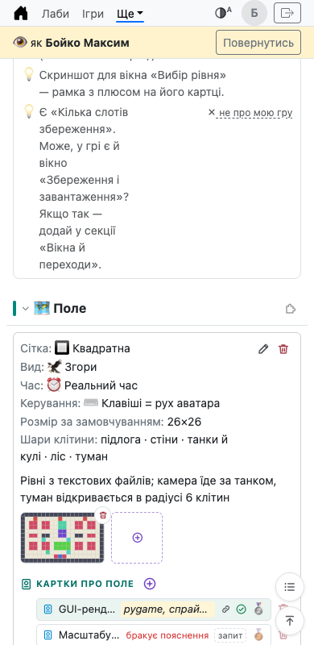

# T344 · Сторінка гри: дрібниці — стани чипами, рядки відео, «Можливості» без прокрутки, картки під мишкою, нагору з меню, смужка «Очима студента» — план і звіт

`2026-11-16` · ⚙️ задача · вибори — [T347](../T347-Q--game-trifles-choices.md) · пропозиції — [T345](../../../games/.t/T345-P--state-looks.md) (кольори й значки станів), [T346](../T346-P--course-dates.md) (дати курсу)

Запит Vitalik 2026-11-17, чат (диктовка перед сном і два дописи під час роботи). Дослівні уривки — під кожним пунктом.

## Запит по пунктах

✅ зроблено · 💬 відповідь нижче · 💡 пропозиція тікетом · ❓ вибір у T347 (мовчання = «a»)

1. ✅ Стани сутності: редагування на місці. ❓ Q3, Q4
   - «При цьому кліку шрифт дуже великий стає. І поле перетворюється на просто текст.»
   - «можливо, варто було би зробити їх типу як теги… ти вводиш, і це кружечко перетворюється дійсно на це, як окрема штучка»
   - 💬 «Якщо ти перейменуєш, то в правилах воно не перейменується, а зламається. Правильно?»
   - 💡 кольори станів із готового набору, значки станів — [T345](../../../games/.t/T345-P--state-looks.md). ❓ Q1, Q2
2. ✅ «Асинхронний захист · без дедлайну» — не зовсім так: підпис виправлено. 💡 центральне місце для дат — [T346](../T346-P--course-dates.md). ❓ Q5–Q7
   - «Межа дедлайну все ж таки є. Загальна межа, я не пам'ятаю, чи до 20 грудня, чи 27-го… останній тиждень перед сесією»
   - «Десь центральне місце, де якісь такі штуки, які із року в рік міняються… Не знаю, як думаєш?»
3. ✅ Золоті картки в «Відео»: «коли на них клікаєш, можна було б перейти наверх та й… подивитися, де саме вона.» 💬
4. ✅ Нотатка в рядку відео: «нотатку тут для демки захисту і золотих карток нібито не можна додати. Це ж якийсь баг» 💬
5. 💬 «бракує пояснення»: «Це через те, що у студента просто були вже додані ці картки, які ми відправили в не базові?»
6. ✅ Панель «Можливості» без прокрутки. 💬 кнопки вигляду, «Еталон основи». ❓ Q8
   - «Хочеться, щоб відкрив і одразу приблизно бачив перелік… що там взагалі є, чого немає, і щоб міг легко додати.»
7. ✅ Картки під мишкою. ❓ Q9
   - «щоби вони не дратували постійним з'являнням і дуже повільним зниканням»; «може, прям тут можна налаштовувати на кожній підказці»
8. ✅ Нагору з меню. ❓ Q10
   - «коли ти клікаєш на менюшку, не на конкретний пункт меню, а в цілому по менюшці»; «там підказка, що можна клікнути не лише на неї, а можна клікнути просто на менюшку»
9. ✅ Смужка «Очима студента» прилипає; механізм спільний. ❓ Q11, Q12
   - «отой блочок, типу „я дивлюся як студент“, можливо, його також треба фіксувати… механізм спільний для цього, мабуть, варто зробити заздалегідь»

## Відповіді на питання

- **Перейменуєш стан — у правилах зламається?** Так було: правило називає стан словом, і після перейменування на картці лишалось зі старим словом, підкресленим хвилькою «такого стану в сутності нема». Тепер перейменування — одна дія: слово міняється на картці й у всіх правилах, що говорять про стан саме цієї сутності. «Повернути» відкочує і те, й інше.
- **Золоті картки зʼявляються самі?** Так: щойно в грі заявлено золоту (🥇, 👑) картку, у «Відео» зʼявляється її рядок; зняв заявку — рядок зник. Назва в рядку тепер веде до місця заявки в грі.
- **Нотатку не додати — баг?** Так: нотатка жила на посиланні, тож без посилання її не було куди писати, а з посиланням «＋ нотатка» ховалась до наведення мишки. Тепер вона є в кожному рядку й видна блідою.
- **«Бракує пояснення».** Ти зрозумів правильно: це заявка на картку, яка після «Основи й більше» стала «за запитом», а речення-пояснення при ній нема, бо її додали до поділу (або засіяли демо-грою). Нічого не губиться: заявка стоїть, монетка чекає; клік по рядку — і можна дописати речення. У справжніх студентів таких заявок бути не повинно: до поділу начинка гри була відкрита лише тобі.
- **Куди зникли кнопки вигляду?** Нікуди: це можливість «Налаштування вигляду» в «Можливостях» → «Сторінка». Читач чужої гри бачить їх завжди, власник вмикає сам; ти дивився «очима студента» — тобто як власник. Чи вмикати їх одразу — Q8.
- **«Еталон основи» — про що?** Еталон — зразковий опис гри-основи (їх сімнадцять). З увімкненою можливістю порожню гру можна «почати з еталона», а під «чого бракує» зʼявляється рядок «в еталоні є ще N карток, яких нема в тебе». Пояснення в панелі переписав цими словами.
- **Смужка «очима» — чи не зламається багато?** Ні: усе, що прилипає під меню, і так читало одну висоту; тепер це висота полиці (меню + смужка), тож заголовки секцій і шапки карток самі стали нижче.

## Що зроблено

### 1. Стани — пігулки

- Стан — окрема пігулка. Клік по ній — поле просто в пігулці, тим самим шрифтом (12 px, як і було в спокої).

  
- Enter — перейменовано на картці й у правилах; внизу «Змінено: стан «…» → «…» — і в правилах (N)» з «Повернути».

  
- З олівцем картки: мінус на кожній пігулці й «＋ стан». Набрав, Enter — пігулка є, наступна вже відкрита; через кому — кілька одразу; Esc — досить.
- Чиї правила перейменовуються: де сутність названа прямо, або стороною «А» / «Б» умови «коли»; «будь-хто стає «злий»» — лише якщо такого стану нема в інших сутностей.
- Сервер: `POST /api/my/game/parts/{id}/states/rename` (`routes/my_states.py`), історія — рядок сутності й рядок кожного правила.

### 2–4. Рядки «Відео»

- «＋ нотатка» в кожному рядку, і без посилання: «зніму після лаби 4». Перше посилання забирає нотатку собі.
- Назва золотої картки — посилання з пунктиром: під мишкою картка каталогу, клік веде до заявки в грі.
- «Асинхронний захист · на 70+ · до кінця семестру»; у підказці — «свого дедлайну нема, лише загальна межа курсу».

### 6. «Можливості»

- Пʼятнадцять можливостей у два стовпці, рядок на кожну; основа — одним рядком назв.
- Що додає рядок — унизу панелі, поки мишка на ньому; висота панелі не міняється.
- Панель завжди у вікні: не влазить ні вниз, ні вгору — зсувається поверх своєї кнопки (це правка для всіх спливних панелей сайту).

### 7. Картки під мишкою

- Картка зʼявляється, коли мишка **зупинилась** на слові: поки ведеш мишку по рядку — нічого.
- Сторінка, що прокручується під нерухомою мишкою, карток не відкриває.
- Зникає швидше: 0,25 с після слова (було 0,35), 0,35 с після картки (було 0,6).
- Темп — значок унизу кожної картки: швидко 0,15 с · звично 0,4 с · повільно 0,9 с · після паузи 1,8 с; памʼятається в браузері.
- Після кліку по слову, чий клік — власна дія (перехід, редагування), картка не вискакує, поки мишка не піде й не вернеться.

### 8. Нагору з меню

- Прокручено — клік по порожньому місцю меню веде нагору, як клік по порожньому місцю прилиплого заголовка веде на початок секції.
- Під мишкою в меню зʼявляється «↑»; над порожнім місцем вона підсвічується й за пів секунди каже, що клікати можна й по меню. Місце під неї тримається завжди — пункти не зсуваються.

### 9. Полиця вгорі

- Меню й смужка «Очима студента» стоять в одній прилиплій шапці; її висота — `--nav-h`, під нею прилипає все решта.
- `#top-shelf` у шапці — місце, куди сторінка може прикріпити свою смужку (`<Teleport defer to="#top-shelf">`).
- На телефоні смужка коротша: «👁 як Бойко Максим».

## Перевірено

- Смоуки: `smoke_videos` 33/33, новий `smoke_states` 14/14.
- Збірка обох сайтів (python і ods) після кожного кроку.
- QA-агент (Opus) на стенді в headless Chrome, три кола, 1440×900, 1280×720, 390×800, темна тема; консоль чиста. Числа:
  - поле в пігулці 12,16 px = пігулка в спокої; перша пігулка на тому самому місці без олівця, з олівцем і з девʼятьма станами;
  - картка зʼявляється через 403–408 мс після зупинки мишки; 1,2 с безперервного руху — жодної; після прокрутки під нерухому мишку — жодної за 1,5 с; зникає за 252 / 352 мс; «повільно» — 903–908 мс;
  - клік по порожньому місцю меню й по «↑» — нагору; угорі сторінки клік нічого не робить;
  - `--nav-h` = висота шапки: 97 / 73 px зі смужкою, 57 / 33 без; заголовок секції прилипає рівно під нею;
  - панель «Можливості» у вікні на всіх висотах кнопки (21 позиція на двох розмірах вікна);
  - після кліку по золотій картці верх заявки на 11–13 px нижче прилиплої шапки.
- Знімки стенда — `.dev/.drafts/T344/shots/`, сценарії — `.dev/.drafts/T344/scripts/` (`up.sh` / `down.sh`, `t1…t7`, `f*`, `g*`).

## Не перевірено

- Справжня мишка й трекпад: темп карток міряно синтетичними подіями. Чи 0,4 с — «достатньо швидко й не дратує», скажуть лише твої руки (Q9).
- Firefox і Safari: захист від прокрутки спирається на те, що браузер шле події миші з незмінними координатами; перевірено в Chrome.
- Справжній дотик на телефоні (тап по меню — лише емуляція).
- Дев-API не перезапускався: перейменування стану й нотатка без посилання запрацюють у деві після перезапуску.

## Що помітив поза запитом

1. Меню після прокрутки дрібнішає й зсуває пункти на 4–29 px — випадковість (клас `small` збігся з Bootstrap), було й раніше. ❓ Q13
2. «Нагору» плавною прокруткою зупиняється на 1–4 px від верху: шапка в цю мить росте, і браузер підкручує сторінку. Оком не видно.
3. Після переходу на секцію за якорем між полицею й заголовком лишається ≈67 px: відступ тримає місце для прилиплого заголовка, яким у цю мить є сам заголовок. Було й раніше.
4. У меню «Максим Бойко», у смужці «Бойко Максим».
5. Картка вікна з картинкою, що довантажується, один раз помітно переїжджає, коли біля низу вікна.

## Коміти

Чотирнадцять комітів коду й три — доків, без push:

- `fix: a video's note can be written before its link` · `feat: a gold card's video row leads to the card in the game` · `fix: an async defense is due by the semester's end` · `style: «＋ нотатка» of a video row is easier to see at rest`
- `feat: an entity's states are pills, renamed with their rules` · `fix: a block's caption stays by its first line of pills`
- `feat: «Можливості» show everything at once, nothing to scroll` · `fix(core): a floating panel stays in the window, below the shelf` · `fix: «show me where» lands below a card's stuck head`
- `feat(core): cards under the mouse wait for a still mouse` · `fix(core): a card under the mouse finds its place again as it grows`
- `feat(core): a shelf at the top — «Очима студента» stays in sight` · `feat(core): a click on the menu's empty space goes to the top` · `fix(core): «Очима студента» takes one line on a phone`

Деплой — **з перезапуском API** (нове поле `Video.note`, новий маршрут `states/rename`); бот не мінявся.

## Файли

- Сервер: `routes/my_states.py` (новий), `routes/my_videos.py`, `videos.py`, `models/video.py`, `main.py`; смоуки `smoke_states.py` (новий), `smoke_videos.py`.
- Сторінка гри: `StateChips.vue` (новий), `EntityStats.vue`, `PartBlock.vue`, `VideoRow.vue`, `videos.js`, `FeaturesPanel.vue`, `FeatureRow.vue`, `features.js` (текст), `GameEditor.vue` (відступ переходу), `api.js`.
- Ядро: `peek.js`, `PeekCard.vue`, `PeekPace.vue` (новий), `NavBar.vue`, `App.vue`, `ViewBar.vue`, `Pop.vue`.
