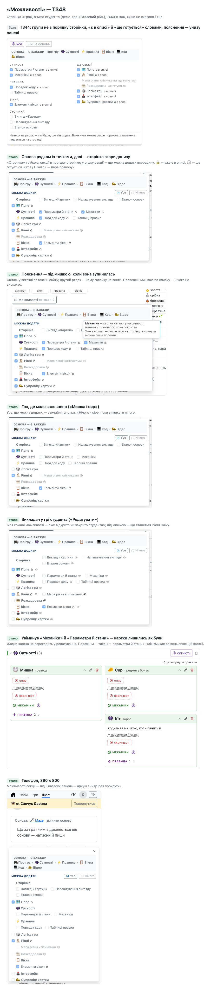

# T348 · «Можливості» — цукерка: мапа сторінки, «Усе / Нічого», значки й підказки під мишкою; олівець не вмикається сам; панель не скаче — план і звіт

`2026-11-17` · ⚙️ задача · попередня версія панелі — [T344](../T344--game-trifles/plan.md) §6 · вибори — [T349](../T349-Q--features-candy-choices.md) (мовчання = «a»)

Запит Vitalik 2026-11-17, чат (диктовка й два дописи під час роботи). Дослівні уривки — під кожним пунктом.

## Запит по пунктах

1. Основа — перелік з нового рядка, тонка точка між пунктами, значок «Про гру».
   - «Давай перелік цих моментів, які є завжди, на новому рядку напишемо, тому що зараз рядок відео переноситься на новий рядок»
   - «Може, варто тоненьку точечку між цими пунктами зробити, щоб було зрозуміло, що це перелік?»
2. «Усе» з плюсиком — не той значок і колір: це не додавання, а «поставити всі галочки»; може, праворуч.
3. «Лише основа» — неправильна назва: лишається ще й заповнене; пара має бути двома сторонами однієї медалі.
   - «типу «виділити все, прибрати все»»
4. Порядок — як на сторінці: спершу «Сторінка» трійкою, далі поле, сутності, правила…
5. «ще готується» і «є в описі» — значками з підказкою.
6. Підказка внизу чи власна швидка під мишкою; чорна підказка — дивно.
7. Заголовки великими літерами зливаються — інший колір.
8. Чи варто максимальне зусилля; чи це рівень Fable.
9. Допис: увімкнув «Механіки» — усі сутності перейшли в режим редагування.
10. Допис: клацаєш «Сторінку» (вигляд «Картки»…) — кнопка й панель переміщаються.

## Відповіді на питання

- **Олівець на всіх сутностях — навмисно?** Так, але це була погана задумка (моя, T321): увімкнення можливості вмикало олівець на всіх картках її виду, щоб «＋ параметр» було видно одразу. Для «Механік» це й не треба було: їхній блок із «＋» видно й так. Тепер жодна картка сама в редагування не переходить.
- **Чому скакала панель.** У рядку кнопок перед «Можливостями» стояли «Опис | Картки» й «усе / коротко / згорнуто», а саме галочки «Сторінки» їх показують і ховають: кнопка їхала вбік, панель — за нею.
- **Внизу чи під мишкою?** Під мишкою. Низ панелі змушував очі бігати від рядка вниз і тримав два порожні рядки висоти. Підказку тепер видно біля самого рядка, але не одразу на кожному: вона приходить, коли мишка зупинилась (≈0,3 с), а далі з рядка на рядок — без затримки. Колір — як у пояснень сайту (світле з тонкою блакитною рамкою), не чорний.
- **Чи варто максимальне зусилля, чи це рівень Fable?** Це шліфування готової панелі за чіткими зауваженнями — мій рівень; Fable варта нової концепції, тут її нема. Максимум дав ретельніший перебір варіантів (мапа сторінки, пара кнопок, де живе пояснення), але головне в такій роботі — подивитись на результат у браузері й поправити побачене (жовтий фон замочків, крапка в кінці рядка на телефоні). Для такого вистачить «високого»; максимум — для задач, де треба придумати, а не відшліфувати.

## Що зроблено

1. **Основа** — підпис окремо, перелік — наступним рядком, тонка точка «·» між назвами; у «Про гру» — 🎮. Перенесеться на вузькому екрані — новий рядок почнеться з назви, не з точки.
2. **«Можна додати» — мапа сторінки згори донизу**: спершу «Сторінка» трійкою (вигляд «Картки», налаштування вигляду, еталон), далі секції в порядку сторінки — поле, сутності, правила, логіка гри, рівні, розкадровка, вікна, інтерфейс, супровід. Секція, що сама є можливістю, — галочка з її значком і назвою; секція основи — назва без галочки, а в її рядку — що можна додати всередину («👾 Сутності — параметри й стани · механіки»). «💻 Код» нічого не додає — його в мапі нема, він в основі.
3. **«Усе / Нічого»** — пара однакових кнопок праворуч від «Можна додати»: значок поставленої й порожньої галочки, без плюса й фіолетового. «Нічого» вимикає все, що можна: заповнене лишається (на ньому замочок); сіріє, коли вимикати нічого, і під мишкою каже чому.
4. **Стани значками**: «є в описі» — 🔒, «ще готується» — 🕓; під мишкою — що це значить. Підказка самої назви — що додає можливість, а другим рядком — чому галочку не зняти.
5. **Підказка під мишкою** — у ядрі (`core/ui/hint.js`, `v-hint`): над елементом, світла; провів мишкою по списку — нічого; клавіатура (Tab) і дотик на телефоні теж показують.
6. **Заголовки**: «ОСНОВА — Є ЗАВЖДИ» сірий (нічого не клацається), «МОЖНА ДОДАТИ» — синій, як галочки під ним. Назви секцій — жирні, можливості всередині — звичайні.
7. **Не скаче**: «Можливості» — перші в рядку кнопок; якщо від галочки над кнопкою зʼявиться чи зникне плитка (рівні, картки) — сторінка прокрутиться на стільки ж, і панель лишиться під мишкою.
8. **Олівець не вмикається сам**: «Механіки», «Параметри й стани», «Елементи вікон», «Мапа» — жодна картка не переходить у редагування. Порожнім карткам — тихий рядок «＋ параметри й стани» (клік вмикає олівець лише цій картці); рівню без мапи — «＋ намалювати рівень».
9. Попутно: блок «Ще можна описати» в кінці сторінки тепер теж у порядку сторінки.

## Перевірено

- Збірка обох сайтів (python і ods) після кожного кроку.
- Стенд 8033 / 5033 / 9335, база `python_labs_t348_stand`, headless Chrome через CDP; скрипти — `.dev/.drafts/T348/scripts/` (`up.sh`, `t1`…`t5`):
  - «Сталевий рій» (усе заповнене): панель 584 × 361 (була ≈ 440 заввишки); три галочки «Сторінки» — кнопка й панель на тих самих координатах до пікселя;
  - підказка «Механіки»: білий фон, два рядки; провести мишкою по списку кроками 40 мс — жодної;
  - «Мишка і сир» (мало заповнено): «Механіки» й «Параметри й стани» ввімкнено — 0 карток у редагуванні; три тихі «＋ параметри й стани»; клік по одному — олівець лише на цій картці;
  - викладач у грі студента («Редагувати») — око біля кожної з 15 можливостей, підказка ока;
  - телефон 390 × 800 — аркуш 374 × 560, без горизонтальної прокрутки; 1280 × 720 — панель у вікні; темна тема.

## Не перевірено

- Справжня мишка й трекпад: затримку підказки (0,3 с) міряно синтетичними подіями.
- Firefox і Safari (`overflow-x: clip` у переліку основи — з Safari 16).
- Плитка, що переносить рядок над кнопкою: компенсацію прокруткою не відтворено — на 1440 і 1280 плитки влазять в один рядок.

## Що помітив поза запитом

1. Чорні швидкі підказки (`qtip`) лишились на інших значкових кнопках сайту. ❓ [T349](../T349-Q--features-candy-choices.md) Q1
2. Блок «МЕХАНІКИ ⊕» стоїть на кожній картці сутності й порожнім, а параметри тепер — тихим рядком. ❓ Q2

## Коміти

Без push; бекенд не мінявся — дев підхопить сам, перезапуск API не потрібен.

- `fix: turning a feature on leaves the cards' pencils alone`
- `fix: «Можливості» stay put as the page changes under them`
- `feat(core): a light hint under a mouse that stopped`
- `feat: «Можливості» as a map of the page, «Усе / Нічого», signs`

## Файли

- Сторінка гри: `features.js` (`place` замість `group`, `BASE` з `place`), `edFeatures.js` (`turnOn` прибрано), `ed.js`, `FeaturesPanel.vue`, `FeatureCheck.vue` (був `FeatureRow.vue`), `MoreRow.vue`, `GameEditor.vue`, `EntityStats.vue`, `LevelCard.vue`.
- Ядро: `core/ui/hint.js` (новий), `core/ui/style.css` (`.hint-box`), `core/ui/components/Icon.vue` (`boxcheck`, `box`, `lock`).
